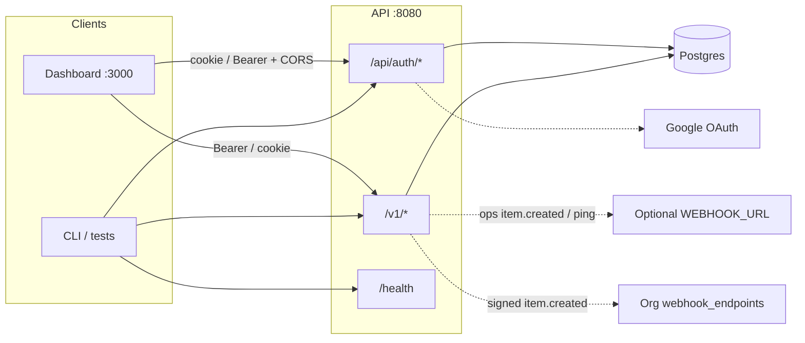
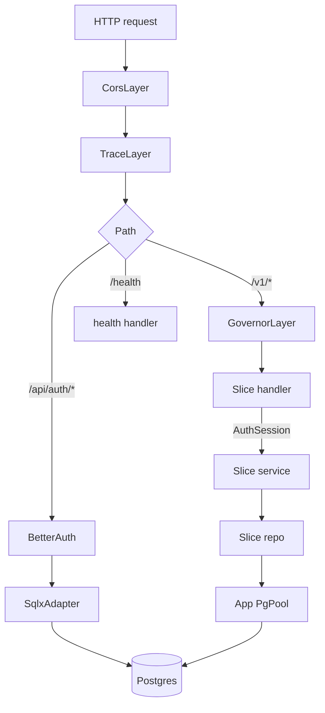
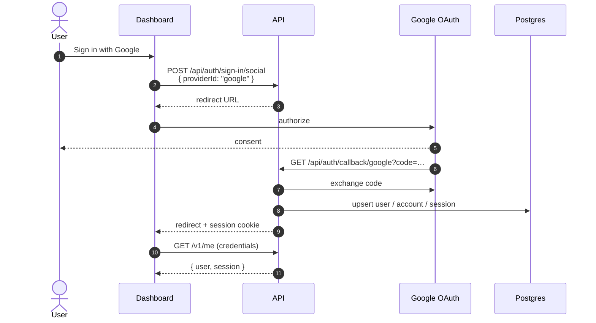
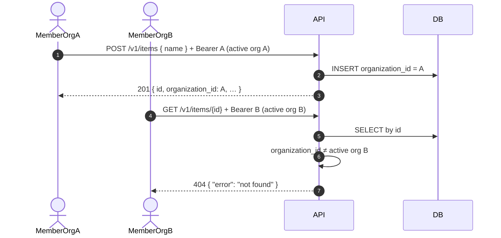
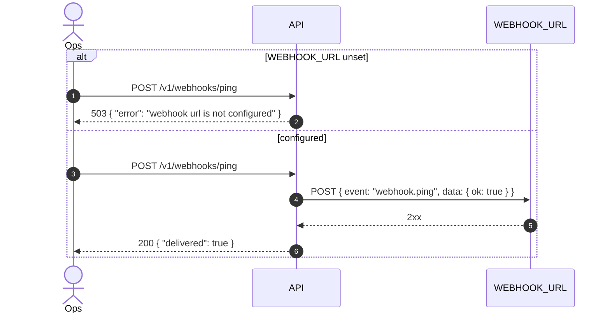

# API

Versioned HTTP API for the SaaS template. Owns authentication (including the organisation plugin), session-backed authorization, and org-scoped business slices: account (`/v1/me`), items, webhooks, and notifications. The dashboard is the primary client; Postgres is the system of record.

|                      |                                                                                                                               |
| -------------------- | ----------------------------------------------------------------------------------------------------------------------------- |
| **Base URL (local)** | `http://localhost:8080`                                                                                                       |
| **Business API**     | `/v1/*`                                                                                                                       |
| **Auth protocol**    | `/api/auth/*` (better-auth wire-compatible)                                                                                   |
| **OpenAPI**          | [`/swagger-ui/`](http://localhost:8080/swagger-ui/) · [`/api-docs/openapi.json`](http://localhost:8080/api-docs/openapi.json) |
| **Stack**            | Axum 0.8 · SQLx · Postgres · even-better-auth · reqwest · tower_governor · utoipa                                             |

> **Security note:** [even-better-auth](https://docs.rs/even-better-auth) is pre-1.0 and not security-reviewed. Suitable for templates and local development; treat production hardening as a follow-up.

---

## Table of contents

1. [System context](#1-system-context)
2. [Architecture](#2-architecture)
3. [Sequence diagrams](#3-sequence-diagrams)
4. [Authentication](#4-authentication)
5. [Authorization](#5-authorization)
6. [HTTP API contract](#6-http-api-contract)
7. [Errors](#7-errors)
8. [Rate limiting](#8-rate-limiting)
9. [CORS & trusted origins](#9-cors--trusted-origins)
10. [Configuration](#10-configuration)
11. [Local development](#11-local-development)
12. [Testing](#12-testing)
13. [Observability & ops](#13-observability--ops)
14. [Design decisions & limitations](#14-design-decisions--limitations)

---

## 1. System context



**Responsibilities**

| Concern                                                   | Owner                                     |
| --------------------------------------------------------- | ----------------------------------------- |
| Identity, sessions, OAuth, admin roles, organisations     | `/api/auth` (even-better-auth)            |
| Business resources (`me`, items, webhooks, notifications) | `/v1` domain slices → SQLx                |
| Liveness for orchestrators                                | Unversioned `GET /health` (no rate limit) |
| Machine-readable contract                                 | OpenAPI 3 via utoipa                      |

---

## 2. Architecture

Vertical domain slices — product areas typically own handler + service + domain + repo. Thinner slices: `health/` and `account/` (handler + domain only). Cross-cutting auth, DB pool, and middleware stay shared.

```text
src/
  lib.rs                  # crate root + module tree
  main.rs                 # bootstrap: config, SQLx migrate!, auth::build, serve
  app.rs                  # router merge of slices, CORS, governor, Swagger
  auth/                   # BetterAuth build, Actor, org helpers, invitation hooks
  state.rs                # AppState + FromRef<BetterAuth> for AuthSession
  config.rs               # env → typed Config
  health/                 # /v1/health (handler + domain)
  account/                # /v1/me (handler + domain)
  items/                  # handler + service + domain + repo
  webhooks/               # handler + service + domain + repo
  notifications/          # handler + service + domain + repo
  infrastructure/         # database.rs — PgPool connect
  middleware/             # rate_limit
  error.rs                # AppError → HTTP + ErrorBody
  openapi.rs              # ApiDoc + bearerAuth scheme
```



**Invariants**

- Same Postgres instance for auth tables, items, webhooks, and notifications.
- `/api/auth` is **outside** the `/v1` governor layer (auth has its own limits).
- Protected `/v1` routes require a valid session (`AuthSession`); missing/invalid → **401**.
- Org-scoped resources also require `activeOrganizationId` on the session (**400** when unset).
- Requests for an item/webhook/notification outside the active organisation get **404** (no existence leak), not 403.

---

## 3. Sequence diagrams

### 3.1 Email sign-up → create item → list org items

```mermaid
sequenceDiagram
  autonumber
  actor Client
  participant API as API :8080
  participant Auth as BetterAuth
  participant DB as Postgres

  Client->>API: POST /api/auth/sign-up/email<br/>{ email, password, name }
  API->>Auth: sign-up
  Auth->>DB: insert user, account, session
  Auth-->>API: 200 + Set-Cookie + set-auth-token
  API-->>Client: session established

  Note over Client,Auth: Create/set active organisation via /api/auth/organization/*

  Client->>API: POST /v1/items<br/>Authorization: Bearer &lt;token&gt;<br/>{ "name": "Widget" }
  API->>API: AuthSession + activeOrganizationId + rate limit
  API->>DB: INSERT items (user_id, organization_id, name)
  opt WEBHOOK_URL set
    API-->>API: best-effort unsigned POST item.created
  end
  opt org webhook_endpoints for item.created
    API-->>API: best-effort signed POST to each endpoint
  end
  API-->>Client: 201 Item

  Client->>API: GET /v1/items<br/>Authorization: Bearer &lt;token&gt;
  API->>DB: SELECT … WHERE organization_id = $activeOrg
  API-->>Client: 200 [Item, …]
```

### 3.2 Google OAuth (browser)



Redirect URI (local): `http://localhost:8080/api/auth/callback/google`.

### 3.3 Organisation tenancy (IDOR-safe)



Members of the **same** active organisation can read that org’s items. Platform admins do **not** bypass org scope on `/v1` items.

### 3.4 Outbound webhook ping



---

## 4. Authentication

Protocol is **better-auth compatible** under `/api/auth`. Prefer the [better-auth client](https://www.better-auth.com/) in the dashboard; curl/Bearer works for scripts and tests.

### 4.1 Session transport

| Mechanism  | How                                                                                                              |
| ---------- | ---------------------------------------------------------------------------------------------------------------- |
| **Cookie** | Browser clients; CORS credentials + `TRUSTED_ORIGINS`                                                            |
| **Bearer** | `Authorization: Bearer <token>` — token from `set-auth-token` response header on sign-up/sign-in (bearer plugin) |

Exposed CORS header: `set-auth-token` (so SPAs can read the Bearer token if needed).

### 4.2 Core auth endpoints

| Method | Path                        | Purpose                                                          |
| ------ | --------------------------- | ---------------------------------------------------------------- |
| `POST` | `/api/auth/sign-up/email`   | Register with email/password                                     |
| `POST` | `/api/auth/sign-in/email`   | Sign in                                                          |
| `POST` | `/api/auth/sign-in/social`  | Start OAuth (`providerId: "google"`)                             |
| `GET`  | `/api/auth/callback/google` | OAuth callback                                                   |
| `GET`  | `/api/auth/get-session`     | Current session                                                  |
| `POST` | `/api/auth/sign-out`        | End session                                                      |
| `*`    | `/api/auth/admin/*`         | Admin plugin (roles, user admin)                                 |
| `*`    | `/api/auth/organization/*`  | Organisation plugin (create/list/set-active/members/invitations) |

Organisation nested **teams** are disabled. Invitation emails are a `tracing::info!` stub in local/dev (invitations still persist).

Full auth surface is large; use Swagger for `/v1` and better-auth docs for `/api/auth`. This README documents the **app contract** and how auth plugs into it.

### 4.3 Example: sign-up and call `/v1`

```bash
# Sign up — capture set-auth-token
TOKEN=$(curl -sD - -o /tmp/signup.json \
  -X POST http://localhost:8080/api/auth/sign-up/email \
  -H 'content-type: application/json' \
  -H 'origin: http://localhost:3000' \
  -d '{"email":"dev@example.com","password":"password1234!","name":"Dev"}' \
  | awk -F': ' 'tolower($1)=="set-auth-token"{gsub(/\r/,"",$2); print $2}')

# Create + activate an organisation (required before items/webhooks)
curl -s http://localhost:8080/api/auth/organization/create \
  -H "authorization: Bearer $TOKEN" \
  -H 'content-type: application/json' \
  -H 'origin: http://localhost:3000' \
  -d '{"name":"Dev Org","slug":"dev-org"}' | jq

curl -s http://localhost:8080/v1/me \
  -H "authorization: Bearer $TOKEN" \
  -H 'origin: http://localhost:3000' | jq
```

### 4.4 Google Cloud setup

1. Create an OAuth 2.0 Client (Web) in Google Cloud Console.
2. Authorized redirect URI: `http://localhost:8080/api/auth/callback/google`
3. Set `GOOGLE_CLIENT_ID` / `GOOGLE_CLIENT_SECRET` (required at process start).

---

## 5. Authorization

Two axes: **authentication** (who) and **authorization** (what), plus **organisation tenancy**.

| Actor                                    | `/v1/me`    | Items / account webhooks         |
| ---------------------------------------- | ----------- | -------------------------------- |
| Anonymous                                | 401         | 401                              |
| Signed in, **no** `activeOrganizationId` | own session | **400** — select an organisation |
| Signed in with active organisation       | own session | Scoped to that `organization_id` |

Items keep a creator `user_id`, but list/create/get/delete and webhook endpoints are filtered by the session’s `activeOrganizationId` for everyone (including platform admins).

**Bootstrap admins** (platform role — separate from org roles)

1. Sign up once, copy `user.id` from `GET /v1/me`.
2. Set `ADMIN_USER_IDS=<id>` and restart, **or**
3. Set `role = admin` via admin plugin / DB once an admin exists (`/api/auth/admin/set-role`).

Platform admin (`user.extra.role` contains `admin`, or id ∈ `ADMIN_USER_IDS`) unlocks **`/api/auth/admin/*`**. `Actor.is_admin` is computed for handlers but **does not** grant cross-organisation access to items, webhooks, or notifications.

---

## 6. HTTP API contract

Stable business surface. Breaking changes → new version prefix (`/v2`), not silent mutation of `/v1`.

### 6.1 Endpoints

| Method   | Path                           | Auth | Rate limit | Success                       | Notes                              |
| -------- | ------------------------------ | ---- | ---------- | ----------------------------- | ---------------------------------- |
| `GET`    | `/health`                      | No   | No         | `200` `{ "status": "ok" }`    | Orchestrator probe                 |
| `GET`    | `/v1/health`                   | No   | Yes        | `200`                         | Same body; versioned               |
| `GET`    | `/v1/me`                       | Yes  | Yes        | `200` `{ user, session }`     |                                    |
| `GET`    | `/v1/items`                    | Yes  | Yes        | `200` `Item[]`                | Active org — all items in that org |
| `POST`   | `/v1/items`                    | Yes  | Yes        | `201` `Item`                  | Body: `{ "name": string }`         |
| `GET`    | `/v1/items/{id}`               | Yes  | Yes        | `200` `Item`                  | Other org → **404**                |
| `DELETE` | `/v1/items/{id}`               | Yes  | Yes        | `204`                         | Active org required                |
| `GET`    | `/v1/webhooks`                 | Yes  | Yes        | `200` endpoints               | Secrets omitted                    |
| `POST`   | `/v1/webhooks`                 | Yes  | Yes        | `201` endpoint                | Secret returned once               |
| `DELETE` | `/v1/webhooks/{id}`            | Yes  | Yes        | `204`                         | Org-scoped                         |
| `POST`   | `/v1/webhooks/{id}/ping`       | Yes  | Yes        | `200` `WebhookDelivery`       | Signed org ping                    |
| `GET`    | `/v1/webhooks/{id}/deliveries` | Yes  | Yes        | `200`                         | Recent deliveries                  |
| `POST`   | `/v1/webhooks/ping`            | No*  | Yes        | `200` `{ "delivered": true }` | Ops `WEBHOOK_URL`                  |
| `GET`    | `/v1/notifications`            | Yes  | Yes        | `200` inbox                   | Org-scoped; `unread` is per user   |
| `POST`   | `/v1/notifications/{id}/read`  | Yes  | Yes        | `204`                         | Mark one read                      |
| `POST`   | `/v1/notifications/read-all`   | Yes  | Yes        | `204`                         | Mark all read for caller           |

Organisation inbox writes on item create and invitation send (actor is auto-marked read). Unread state is per user via `notification_reads`.

\*Ping is unauthenticated by design for ops smoke checks; protect at the edge in production if exposed publicly.

### 6.2 Resources

**Item**

```json
{
  "id": "550e8400-e29b-41d4-a716-446655440000",
  "user_id": "user_abc",
  "organization_id": "org_abc",
  "name": "Widget",
  "created_at": "2026-11-03T12:00:00Z"
}
```

**CreateItem**

```json
{ "name": "Widget" }
```

- `name` is trimmed; empty / whitespace-only → `400` `{ "error": "name must not be empty" }`.

**MeResponse**

```json
{
  "user": { "id": "…", "email": "…", "name": "…", "role": "user", … },
  "session": { "id": "…", "userId": "…", … }
}
```

### 6.3 Interactive docs

| Resource     | URL                                         |
| ------------ | ------------------------------------------- |
| Swagger UI   | http://localhost:8080/swagger-ui/           |
| OpenAPI JSON | http://localhost:8080/api-docs/openapi.json |

Security scheme in OpenAPI: `bearerAuth` (HTTP Bearer).

---

## 7. Errors

Uniform JSON body for application errors:

```json
{ "error": "human-readable message" }
```

| Status | When                                      | Example `error`                                        |
| ------ | ----------------------------------------- | ------------------------------------------------------ |
| `400`  | Validation                                | `name must not be empty`                               |
| `401`  | Missing/invalid session                   | (auth middleware)                                      |
| `403`  | Explicit forbid (reserved)                | `forbidden`                                            |
| `404`  | Missing **or** not in active organisation | `not found`                                            |
| `429`  | Rate limit exceeded                       | governor body + `retry-after` / `x-ratelimit-*`        |
| `502`  | Upstream webhook HTTP failure             | `webhook responded with …`                             |
| `503`  | `WEBHOOK_URL` unset                       | `webhook url is not configured`                        |
| `500`  | Unexpected DB failure                     | `internal server error` (details logged, not returned) |

Clients should branch on **status code**, not string equality of `error`, except where documented for validation.

---

## 8. Rate limiting

- **Scope:** all `/v1/*` routes (token bucket via `tower_governor`).
- **Key:** client IP (`SmartIpKeyExtractor`, proxy-aware when `X-Forwarded-For` is trusted by the deployment).
- **Not limited:** `GET /health`, `/api/auth/*`, Swagger.

| Env                    | Default | Meaning                   |
| ---------------------- | ------- | ------------------------- |
| `RATE_LIMIT_BURST`     | `60`    | Max burst tokens          |
| `RATE_LIMIT_PERIOD_MS` | `1000`  | ms to replenish one token |

On exceed: **429** with `retry-after` and `x-ratelimit-*` headers.

---

## 9. CORS & trusted origins

- Origins from `TRUSTED_ORIGINS` (comma-separated; default `http://localhost:3000`).
- Credentials allowed; methods include GET/POST/PUT/PATCH/DELETE/OPTIONS.
- Allowed request headers: `Accept`, `Authorization`, `Content-Type`.
- Exposed response header: `set-auth-token`.

Browser clients **must** send requests from a trusted origin (and typically `credentials: 'include'` for cookies).

---

## 10. Configuration

Copy `.env.example` → `.env` under `apps/api` (or export in the shell).

| Variable                                    | Required | Description                                                         |
| ------------------------------------------- | -------- | ------------------------------------------------------------------- |
| `DATABASE_URL`                              | yes      | Postgres URL                                                        |
| `BETTER_AUTH_SECRET`                        | yes      | ≥ 32 characters                                                     |
| `BETTER_AUTH_URL` / `BASE_URL`              | no       | Public API URL (default `http://localhost:8080`)                    |
| `GOOGLE_CLIENT_ID`                          | yes      | Google OAuth client id                                              |
| `GOOGLE_CLIENT_SECRET`                      | yes      | Google OAuth secret                                                 |
| `ADMIN_USER_IDS`                            | no       | Comma-separated bootstrap admin user ids                            |
| `TRUSTED_ORIGINS`                           | no       | Comma-separated CORS origins                                        |
| `HOST` / `PORT`                             | no       | Bind (default `0.0.0.0:8080`)                                       |
| `WEBHOOK_URL`                               | no       | Ops outbound URL (unsigned); org endpoints are DB-backed separately |
| `RATE_LIMIT_BURST` / `RATE_LIMIT_PERIOD_MS` | no       | Throttle knobs                                                      |

Fail-fast: missing Google credentials or short secret aborts startup.

---

## 11. Local development

From repo root (Vite+ monorepo package `api`):

```bash
docker compose up -d
cp apps/api/.env.example apps/api/.env
# edit secrets in apps/api/.env

pnpm dev:api
# or: vp run api#dev
# or: cd apps/api && cargo run
```

Migrations:

- App tables: SQLx `migrations/` on boot via `sqlx::migrate!()` in `main`:
  - `001_create_items`
  - `002_items_owner` (destructive recreate with `user_id`)
  - `003_webhook_endpoints`
  - `004_organization_tenancy` (destructive recreate of items + webhooks with `organization_id`)
  - `005_notifications` (`notifications` + `notification_reads`)
- Auth tables: `BetterAuth::migrate()` inside `auth::build()` on boot.
- Template note: `002` / `004` wipe and recreate tables — fine for local scaffold, not for production data.

Useful URLs after boot:

- API: http://localhost:8080/health
- Swagger: http://localhost:8080/swagger-ui/
- Dashboard (separate): http://localhost:3000

### Rustdoc (developer API docs)

Public handlers, services, and validators use rustdoc with narrative prose, `# Errors` (linking `AppError` variants), and `# Examples` where a runnable snippet helps.

```bash
cd apps/api
cargo doc --no-deps --open
# or: pnpm docs
```

Doctests run as part of `cargo test`. Prefer examples on domain/helpers; handler docs focus on behaviour + error mapping (HTTP extractors are awkward in doctests).

---

## 12. Testing

```bash
# from apps/api or via monorepo
cargo test
vp run api#test
```

| Class           | Behavior                                                                                                                                                                                               |
| --------------- | ------------------------------------------------------------------------------------------------------------------------------------------------------------------------------------------------------ |
| Unit            | Domain validation, config, error mapping, auth helpers, webhook signing — no DB                                                                                                                        |
| Integration     | Real Postgres + `auth::build` (SqlxAdapter); skip cleanly if `DATABASE_URL` unreachable                                                                                                                |
| Coverage intent | 401 unauthenticated; active-org **400**; org-scoped CRUD/list; cross-org get → **404**; item delete; account webhooks; notifications + read-all; empty name **400**; rate-limit **429**; OpenAPI paths |

CI tip: provide Compose Postgres + `.env` secrets for full auth suites. Health / OpenAPI / rate-limit / unauthenticated-create tests use a lazy pool + `MemoryAdapter` and do not need a live database.

---

## 13. Observability & ops

- **Tracing:** `tracing` + `TraceLayer`; set `RUST_LOG` / `EnvFilter` (default `info`).
- **Health:** prefer unversioned `GET /health` for k8s/load balancers (not rate-limited).
- **Webhooks:** on item create, best-effort delivery to ops `WEBHOOK_URL` (if set) **and** organisation endpoints subscribed to `item.created` (failures logged, do not fail the create). Org `/ping` and ops `/v1/webhooks/ping` are synchronous smoke checks.
- **Secrets:** never commit `.env`; rotate `BETTER_AUTH_SECRET` and Google credentials like production secrets.

---

## 14. Design decisions & limitations

| Decision                                     | Rationale                                                            |
| -------------------------------------------- | -------------------------------------------------------------------- |
| better-auth wire protocol at `/api/auth`     | One client SDK for TS dashboard + Rust server                        |
| Organisation plugin + `activeOrganizationId` | Tenancy for items/webhooks/notifications without custom org tables   |
| 404 on foreign-org resource get              | Avoid leaking whether an id exists outside the active org            |
| Platform admin ≠ cross-org `/v1` access      | Admin plugin for `/api/auth/admin/*` only                            |
| No Redis in this pass                        | Sessions in Postgres via sqlx adapter — simpler ops for the template |
| `/v1` only for business API                  | Explicit versioning before public consumers proliferate              |
| Items list/create/get/delete                 | Template surface; no PATCH/update yet (same org Actor rules)         |

**Known gaps (intentional for v0.1 template)**

- even-better-auth not production-certified
- No update (PATCH) item endpoint yet
- Ops webhook ping (`POST /v1/webhooks/ping`) is unauthenticated (edge-protect in prod)
- Rate limit is IP-based (shared NAT can throttle unfairly)
- Migrations `002` / `004` drop/recreate tables — wipe expected for this template

---

## Quick reference

```bash
# Health
curl -s http://localhost:8080/health

# Monorepo scripts
pnpm dev:api
vp run api#test
vp run api#build
```

For the live schema, open **Swagger UI** — this README is the narrative contract; OpenAPI is the machine-readable source of truth for `/v1`.
