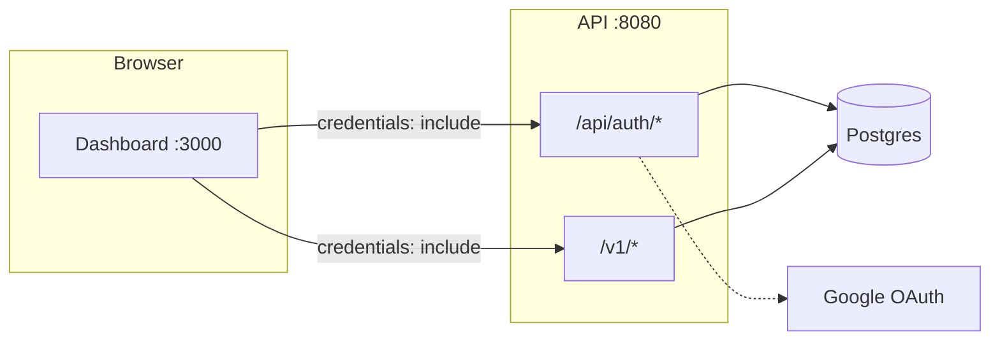
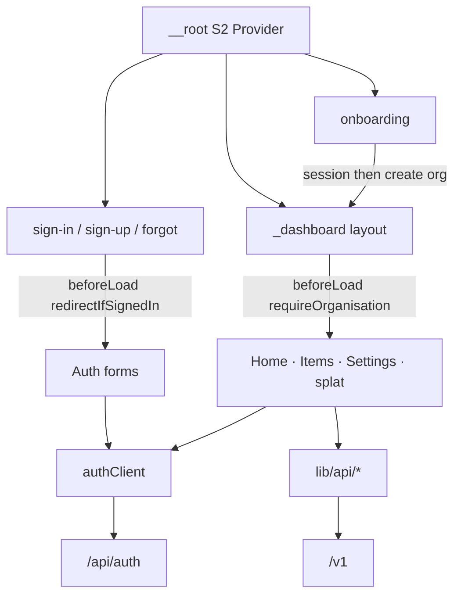
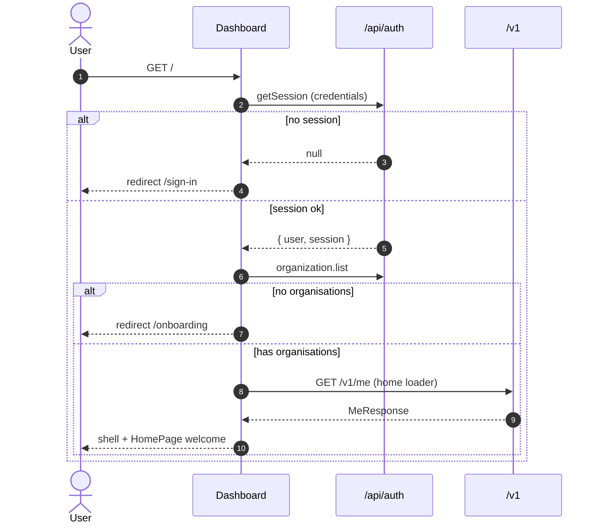
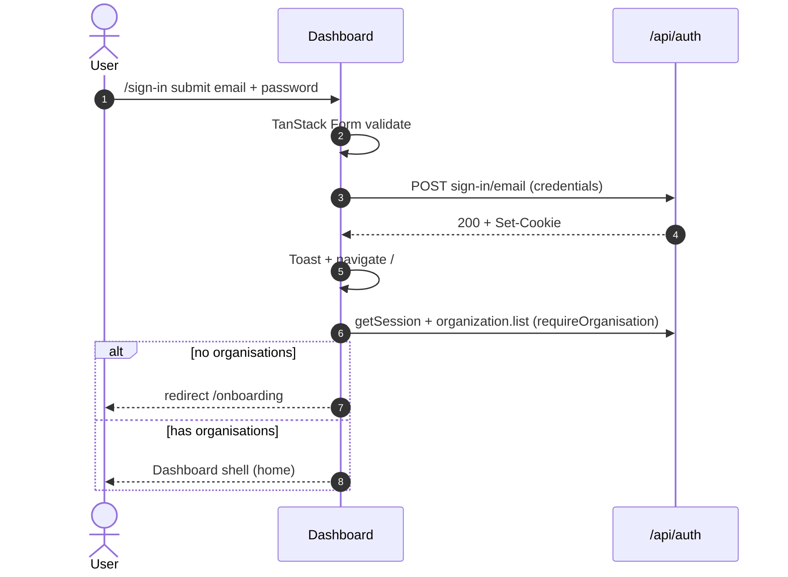
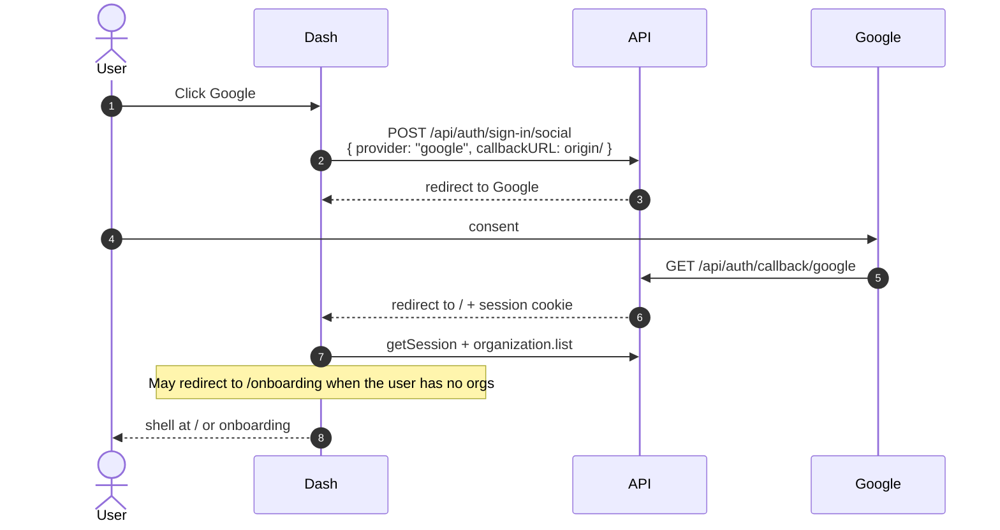
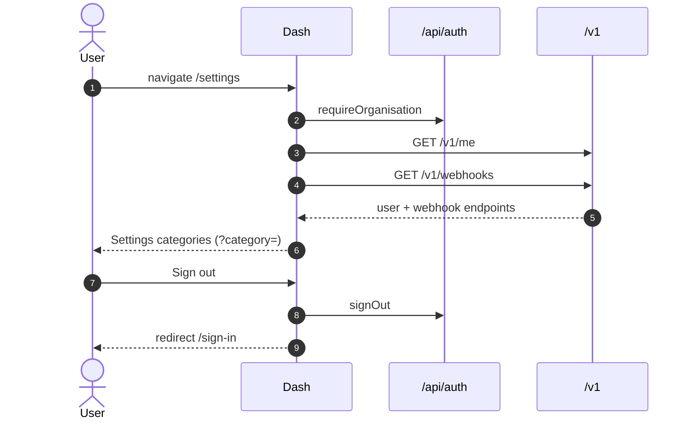
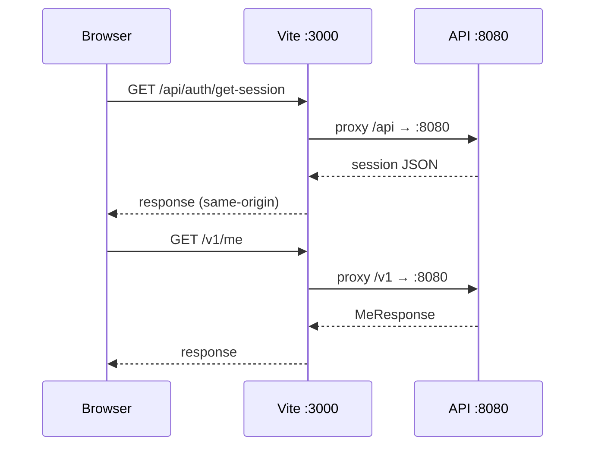
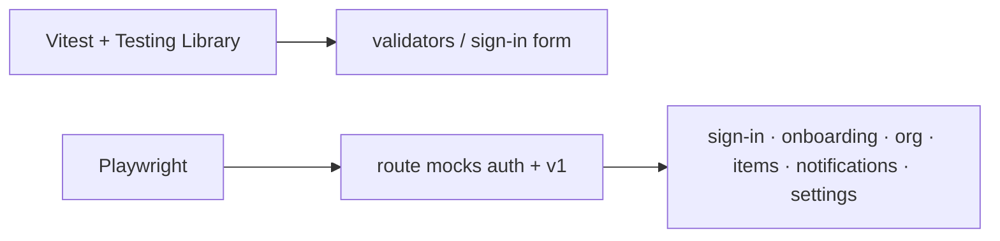

# Dashboard

SPA for the SaaS template. Owns the authenticated product shell (home, items, settings, org switcher, notifications), sign-in/sign-up/onboarding UX, and client-side session + organisation gates. All identity and business data come from the Rust API — this app does not own a database.

|               |                                                                                                                                             |
| ------------- | ------------------------------------------------------------------------------------------------------------------------------------------- |
| **Local URL** | http://localhost:3000                                                                                                                       |
| **Talks to**  | [`apps/api`](../api/README.md) (`/api/auth/*`, `/v1/*`)                                                                                     |
| **Stack**     | React 19 · Vite 8 · TanStack Router/Form · better-auth · React Spectrum S2 · Tailwind v4 (utilities) · Motion · Biome · Vitest · Playwright |

---

## Table of contents

1. [System context](#1-system-context)
2. [Architecture](#2-architecture)
3. [Sequence diagrams](#3-sequence-diagrams)
4. [Routing & navigation](#4-routing--navigation)
5. [Authentication](#5-authentication)
6. [API client](#6-api-client)
7. [Forms & validation](#7-forms--validation)
8. [UI system](#8-ui-system)
9. [Configuration](#9-configuration)
10. [Local development](#10-local-development)
11. [Testing](#11-testing)
12. [Extending the product](#12-extending-the-product)
13. [Design decisions & limitations](#13-design-decisions--limitations)

---

## 1. System context



**Dev proxy vs production**

| Mode            | `VITE_API_URL`           | Browser request target                                              |
| --------------- | ------------------------ | ------------------------------------------------------------------- |
| Local (default) | unset                    | Same origin `/api`, `/v1` → Vite proxies to `http://localhost:8080` |
| Split deploy    | set to API public origin | Direct cross-origin calls (API CORS + cookies required)             |

---

## 2. Architecture

```text
src/
  main.tsx                 # ReactDOM → RouterProvider
  router.tsx               # createTanStackRouter
  routeTree.gen.ts         # generated — do not hand-edit
  routes/                  # thin file routes only
    __root.tsx             # S2 Provider, toasts, devtools
    _dashboard.tsx         # organisation-gated shell (sidebar + main)
    _dashboard/            # /, /items, /settings, splat
    sign-in.tsx | sign-up.tsx | forgot-password.tsx | onboarding.tsx
  lib/
    auth-client.ts         # better-auth + route guards
    api/                   # domain fetch helpers (client, account, items, webhooks, notifications)
  forms/                   # TanStack Form hook + S2 fields
  features/                # domain UI — not a single dashboard dump
    auth/                  # sign-in/up/forgot forms, social
    onboarding/            # create-organisation gate
    shell/                 # sidebar, nav, page skeleton
    home/                  # authenticated home
    items/                 # items table
    settings/              # settings categories + panels
    organisations/         # switcher + settings organisation panel
    notifications/         # inbox popover
  components/              # shared UI (AuthPage, Button, Logo, Typography, …)
  test/                    # Vitest render helpers
```



**Invariants**

- Protected product UI lives under `_dashboard` and always runs `requireOrganisation` (session + at least one org; empty membership → `/onboarding`).
- Auth pages bounce signed-in users to `/` (which then re-checks organisations).
- Session transport is **cookie-first** (`credentials: "include"`); Bearer is available on the API for non-browser clients.
- Organisation switcher and Settings → Organisation call `/api/auth/organization/*`; items/webhooks/notifications require an active organisation on the API.

---

## 3. Sequence diagrams

### 3.1 Cold load of a protected route



### 3.2 Email sign-in → land in shell



### 3.3 Google social sign-in



Requires API Google env + redirect URI `http://localhost:8080/api/auth/callback/google` (see [API README](../api/README.md)).

### 3.4 Settings: load profile + webhooks + sign out



### 3.5 Local proxy path (default)



---

## 4. Routing & navigation

File-based TanStack Router. Generated tree: `src/routeTree.gen.ts` (`pnpm generate-routes` / Vite plugin).

| Path               | File                      | Guard                                | Behavior                                                                                                                 |
| ------------------ | ------------------------- | ------------------------------------ | ------------------------------------------------------------------------------------------------------------------------ |
| `/`                | `_dashboard/index.tsx`    | `requireOrganisation`                | Welcome `HomePage`; loader `getMe()`; optional `?welcome=`                                                               |
| `/items`           | `_dashboard/items.tsx`    | `requireOrganisation`                | Items table; loader `listItems()`                                                                                        |
| `/settings`        | `_dashboard/settings.tsx` | `requireOrganisation`                | Loader `getMe` + `listWebhooks`; categories via `?category=` (profile, email, password, organisation, webhooks, account) |
| `/*`               | `_dashboard/$.tsx`        | `requireOrganisation`                | Placeholder for unknown product URLs                                                                                     |
| `/onboarding`      | `onboarding.tsx`          | session (redirect `/` if orgs exist) | Create first organisation; no dashboard shell                                                                            |
| `/sign-in`         | `sign-in.tsx`             | `redirectIfSignedIn`                 | Email + Google                                                                                                           |
| `/sign-up`         | `sign-up.tsx`             | `redirectIfSignedIn`                 | Register (name derived from email)                                                                                       |
| `/forgot-password` | `forgot-password.tsx`     | `redirectIfSignedIn`                 | `requestPasswordReset`                                                                                                   |

**Sidebar** links come from `src/features/shell/nav-routes.tsx` (`dashboardRoutes`). Adding a sidebar entry without a file route will hit the splat placeholder.

Layout: `_dashboard.tsx` = `DashboardSidebar` + scrollable main; collapse state via `SidebarProvider` + Motion.

---

## 5. Authentication

Client: `createAuthClient` from `better-auth/react` in `src/lib/auth-client.ts` with `organizationClient()`.

| Concern                 | Implementation                                                                       |
| ----------------------- | ------------------------------------------------------------------------------------ |
| Base URL                | `import.meta.env.VITE_API_URL` or same-origin                                        |
| Cookies                 | `fetchOptions.credentials: "include"`                                                |
| Gate in (session)       | `requireSession()` → redirect `/sign-in`                                             |
| Gate in (product shell) | `requireOrganisation()` → session + orgs; empty → `/onboarding`                      |
| Gate out                | `redirectIfSignedIn()` → redirect `/`                                                |
| Email                   | `signIn.email` / `signUp.email`                                                      |
| Google                  | `signIn.social({ provider: "google", callbackURL })`                                 |
| Reset                   | `requestPasswordReset({ email, redirectTo })`                                        |
| Exit                    | `signOut()`                                                                          |
| Organisations           | `authClient.organization` (list/create/setActive/listMembers/inviteMember)           |
| Helpers                 | `activeOrganizationIdFromSession`, `slugifyOrganisationName`, `accountNameFromEmail` |

Wire protocol details, roles, and Bearer tokens: **[API authentication docs](../api/README.md#4-authentication)**.

---

## 6. API client

Domain modules under `src/lib/api/` — shared transport in `client.ts`, resources split by domain.

```ts
// lib/api/client.ts
api<T>(path, init?)   // credentials + JSON; prefers body.error, then body.message
ApiError              // { status, message } on non-OK

// lib/api/account.ts
getMe()               // GET /v1/me → MeResponse

// lib/api/items.ts       listItems / createItem / getItem / deleteItem
// lib/api/webhooks.ts    list/create/delete/ping/deliveries
// lib/api/notifications.ts  list / mark read / mark all read
```

| Type         | Shape                                    |
| ------------ | ---------------------------------------- |
| `MeResponse` | `{ user: AccountUser, session: { id } }` |
| `ApiError`   | `{ status, message }` on non-OK          |

**Patterns**

- Prefer **route loaders** for page data (home, items, settings).
- Prefer **authClient** for identity / organisation mutations.
- No React Query yet — add when caching/invalidation complexity appears.
- Add a new domain module under `lib/api/` for new `/v1/*` resources; keep error mapping consistent (`error` then `message`).

---

## 7. Forms & validation

TanStack Form via `createFormHook` (`src/forms/form.ts`):

- Fields: `TextField`, `CheckboxField` (Spectrum S2)
- Submit: `SubmitButton` (subscribes to `canSubmit` / `isSubmitting`)
- Validators: `src/forms/validators.ts` (`required`, `emailFormat`, `minLength`, `passwordsMatch`, `formatFieldErrors`)

**Demo-only rules (replace for production)**

| Rule            | Where                 | Behavior                          |
| --------------- | --------------------- | --------------------------------- |
| Taken emails    | `checkEmailAvailable` | Mock delay + hard-coded set       |
| Blocked sign-in | `sign-in-form`        | `blocked@example.com` fails async |

Sign-up **name** is not a field — `accountNameFromEmail(email)` supplies it.

---

## 8. UI system

| Layer         | Choice                     | Notes                                                          |
| ------------- | -------------------------- | -------------------------------------------------------------- |
| Components    | React Spectrum S2          | Forms, buttons, toast, menu, icons                             |
| Style macros  | `@react-spectrum/s2/style` | Responsive tokens in TSX                                       |
| Utilities     | Tailwind v4                | Theme + utilities only — **no Preflight** (avoids fighting S2) |
| Motion        | `motion/react`             | Auth entrance, sidebar collapse, social stagger                |
| Font          | Poppins                    | `--s2-font-family-sans`, scale `1.25`                          |
| Skeuo buttons | CSS + S2 context           | Global black/white finishes                                    |

Auth marketing layout: `AuthPage` (split panel + Motion hero slides). Product chrome: `DashboardSidebar`, organisation switcher, notifications bell (org inbox from `/v1/notifications`, unread per user).

---

## 9. Configuration

| Variable       | Required | Description                                                                                                           |
| -------------- | -------- | --------------------------------------------------------------------------------------------------------------------- |
| `VITE_API_URL` | no       | Absolute API origin. Leave unset locally to use Vite proxy. Set for production builds that call the API cross-origin. |

Proxy target when unset: `http://localhost:8080` (`vite.config.ts` proxies `/api` and `/v1`).

API secrets (`BETTER_AUTH_*`, Google, Postgres) live in **`apps/api`** — not in the dashboard.

Suggested `.env` for a split local setup:

```bash
# apps/dashboard/.env
VITE_API_URL=http://localhost:8080
```

Only needed if you bypass the proxy; default monorepo flow leaves this unset.

---

## 10. Local development

**Prerequisites:** Node ≥ 22.18, pnpm, API + Postgres running ([API setup](../api/README.md#11-local-development)).

```bash
# from repo root — both apps
pnpm dev

# dashboard only
pnpm dev:dashboard
# or: vp run dashboard#dev
# or: cd apps/dashboard && pnpm dev
```

Open http://localhost:3000. API health: http://localhost:8080/health.

Scripts below are **`apps/dashboard` package scripts**. From the repo root, `pnpm dev` runs dashboard **and** API in parallel (`vp run --parallel -F dashboard -F api --log labeled dev`).

| Script                                     | Purpose                       |
| ------------------------------------------ | ----------------------------- |
| `pnpm dev` (in `apps/dashboard`)           | Vite on port 3000             |
| `pnpm build`                               | Production bundle             |
| `pnpm preview`                             | Preview build                 |
| `pnpm generate-routes`                     | Regenerate `routeTree.gen.ts` |
| `pnpm test` / `test:watch`                 | Vitest                        |
| `pnpm test:e2e` / `test:e2e:ui`            | Build + Playwright            |
| `pnpm format` / `pnpm lint` / `pnpm check` | Biome                         |

---

## 11. Testing



| Layer          | Location               | Intent                                                            |
| -------------- | ---------------------- | ----------------------------------------------------------------- |
| Unit           | `src/**/*.test.*`      | Validators, form behavior                                         |
| E2E            | `e2e/auth.spec.ts`     | Auth + product UX with **mocked** API (no live Postgres required) |
| Preview server | Playwright `webServer` | `vite preview` on **4173**                                        |

E2E mocks cover `**/api/auth/**` (including `/organization/*`), `**/v1/me`, items, webhooks, and notifications. Keep mocks aligned when auth or tenancy routes change.

---

## 12. Extending the product

**New authenticated page**

1. Add `src/routes/_dashboard/your-page.tsx` with `createFileRoute`.
2. Let the Vite plugin regenerate the route tree (or `pnpm generate-routes`).
3. Add a sidebar entry in `dashboardRoutes` if it should appear in nav.
4. Load data in a `loader` via `api()` / `getMe()`-style helpers.
5. Cover happy path in Playwright if it is user-facing.

**New form**

1. Compose with `useAppForm` and existing field components.
2. Put shared rules in `validators.ts`.
3. Call `authClient` or `api()` only from the route/feature submit handler — keep fields presentational.

**New `/v1` resource**

1. Implement on the API first (OpenAPI + ownership rules).
2. Add a typed helper in the matching `lib/api/<domain>.ts` module (or a new one).
3. Prefer loaders over ad-hoc `useEffect` fetches.

---

## 13. Design decisions & limitations

| Decision                           | Rationale                                                                         |
| ---------------------------------- | --------------------------------------------------------------------------------- |
| Cookie session + Vite proxy        | Simplest local CORS story; production uses `VITE_API_URL` + API `TRUSTED_ORIGINS` |
| better-auth client                 | Matches API `/api/auth` wire protocol                                             |
| Organisation gate before shell     | Users without memberships create an org on `/onboarding`                          |
| Splat placeholder for unknown URLs | Unknown product paths stay inside the shell                                       |
| S2 first, Tailwind utilities only  | Avoid double-reset CSS; Spectrum owns components                                  |
| Biome over ESLint/Prettier         | Fits Vite+ / TanStack scaffold                                                    |
| Mock email availability            | UX demo without a dedicated “check email” API                                     |

**Known gaps (v0.1 template)**

- Home is a welcome hub (further product widgets are intentional add-ons)
- Notifications bell loads the organisation inbox (`/v1/notifications`); unread is per user
- Async email checks are mocked, not wired to the API
- No global React Query cache / optimistic mutations yet
- Google OAuth depends entirely on API + Google Cloud configuration

---

## Quick reference

```bash
pnpm dev                 # dashboard + api
pnpm dev:dashboard       # UI only
vp run dashboard#test
vp run dashboard#build
```

Companion backend docs: [`apps/api/README.md`](../api/README.md).
